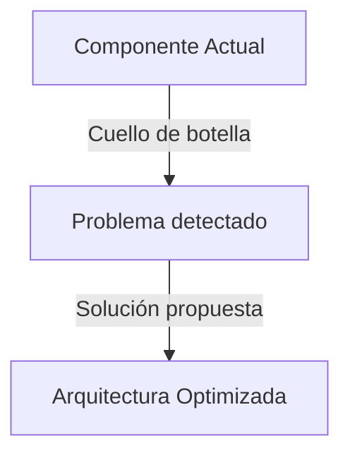

# Agent Artifacts & Clean Chat Protocol (D4KHO Standard)

## Propósito
Garantizar que la ventana de conversación con el desarrollador se mantenga siempre limpia, ejecutiva y ágil, trasladando los análisis técnicos extensos a documentos Markdown interactivos (**Artifacts**) persistidos en disco.

---

## 1. Reglas Críticas (ALWAYS vs NEVER)

- **ALWAYS**: Crear un Artifact Markdown estructurado en disco cuando el usuario solicite un análisis, auditoría, benchmark, diagnóstico de rendimiento o plan de refactorización extenso.
- **ALWAYS**: Escribir el Artifact en `<appDataDir>/brain/<conversation-id>/nombre_reporte.md` (o `docs/analisis/nombre_reporte.md`) utilizando la herramienta de archivos con metadatos:
  ```json
  {
    "UserFacing": true,
    "RequestFeedback": false,
    "Summary": "Resumen conciso del contenido del reporte"
  }
  ```
- **ALWAYS**: En el chat, limitarse a entregar la ficha de identificación del Sub-Agente, un enlace clicable directo (`👉 [reporte.md](file:///...)`), un resumen de 3 a 5 viñetas y 2-3 preguntas clave que requieran decisión humana.
- **NEVER**: Volcar reportes kilométricos o análisis de más de 30 líneas directamente en la ventana de chat.
- **NEVER**: Crear o actualizar artifacts para preguntas cotidianas (ej: "¿dónde está el archivo X?", "¿cómo corro los tests?"). En dudas simples, responder de inmediato en el chat.

---

## 2. Estructura Obligatoria de Todo Artifact Técnico

Cada artifact debe redactarse con los siguientes componentes estándar:

```markdown
# 🏷️ [Título del Análisis o Plan]

> **Proyecto**: Mi Proyecto  
> **Fecha**: YYYY-MM-DD  
> **Diagnóstico / Estado**: [Resumen de 1 línea]

---

## 📌 Resumen Ejecutivo (Executive Summary)
[1 o 2 párrafos concisos con los hallazgos principales y la viabilidad técnica]

---

## 📊 Diagrama de Arquitectura / Flujo (Mermaid)


---

## 🔍 Hallazgos y Causas Raíz
[Desglose detallado con enlaces físicos a los archivos afectados y fragmentos de código exactos]

---

## ⚖️ Matriz de Priorización (Impacto vs. Esfuerzo)
| # | Acción de Mejora | Esfuerzo | Impacto | Prioridad |
|---|---|---|---|---|
| 1 | Corrección de Cuello de Botella | 15 min | Alto | 🔴 Urgente |

---

## 🛠️ Plan de Acción Accionable
[Pasos secuenciales de implementación con fragmentos de código listos para aplicar]
```

---

## 3. Árbol de Decisión: ¿Crear Artifact o Responder en Chat?

```text
¿Es una pregunta de navegación o ubicación ("dónde está X")? → Responder DIRECTO en chat
¿Es una consulta rápida de 1 o 2 párrafos o comando?        → Responder DIRECTO en chat
¿Es una pregunta al usuario para aclarar requisitos?         → Responder DIRECTO en chat
¿Es un análisis técnico, auditoría, benchmark o plan?        → CREAR ARTIFACT en disco
```

